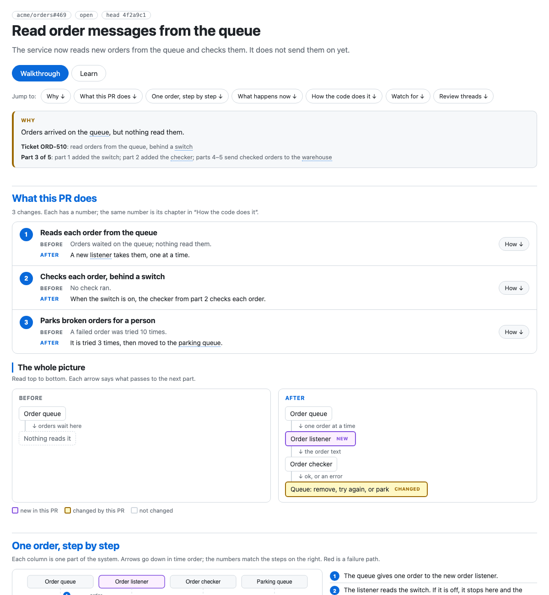
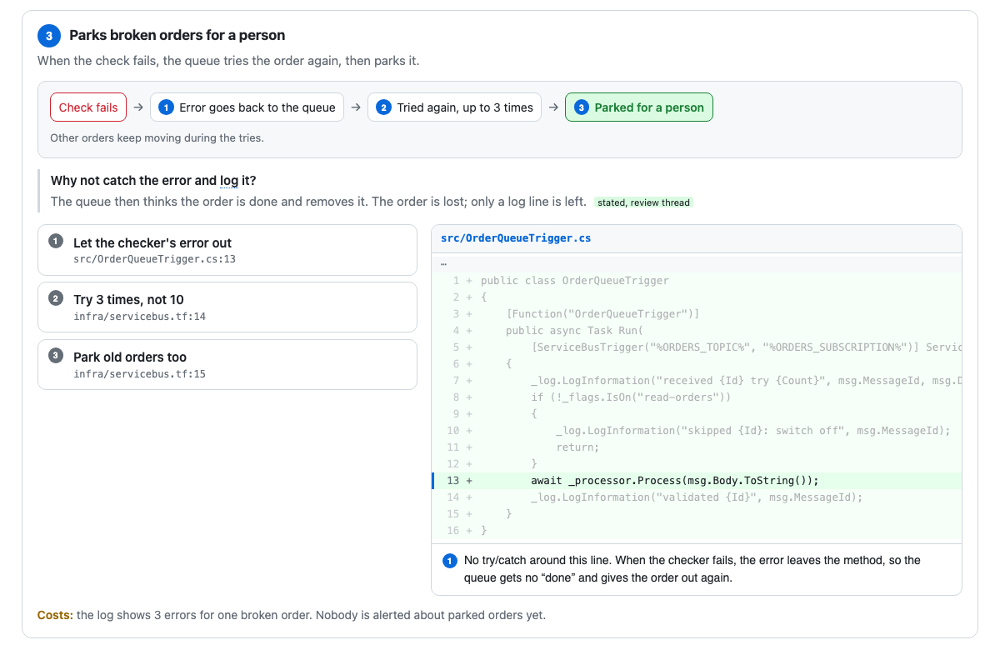

# pr-explain skill

Explains a pull request in plain words, as a page you can ask questions on. Read-only: it never
edits, comments on or approves the PR. Works in GitHub Copilot CLI and Claude Code.

<picture>
  <source media="(prefers-color-scheme: dark)" srcset="docs/page-dark.png">
  
</picture>

Each change gets a chapter: a picture of the flow, the "why not the simple way?" answer, and a
code walk where each step lights its lines.

<picture>
  <source media="(prefers-color-scheme: dark)" srcset="docs/code-dark.png">
  
</picture>

<sub>Sample from a made-up PR.</sub>

## Needs

- [`gh`](https://cli.github.com), logged in (`gh auth login`), with read access to the PR's repo
- `python3` (standard library only)
- Node.js, optional: only to ask questions on the page. Lavish runs through `npx`; no install.

## Install

Copilot CLI:

```sh
git clone https://github.com/pbabu0192/pr-explain-skill ~/.copilot/skills/pr-explain
```

Then run `/skills reload` in Copilot.

Claude Code:

```sh
git clone https://github.com/pbabu0192/pr-explain-skill ~/.claude/skills/pr-explain
```

Both: clone once as above, then `ln -s ~/.copilot/skills/pr-explain ~/.claude/skills/pr-explain`.

## Use

In the chat, in any folder:

- `explain PR owner/repo#123`: the walkthrough and the page.
- `explain PR owner/repo#123 2`: the walkthrough plus a lesson (Learn tab and quiz).
- In Claude Code, `/pr-explain owner/repo#123` also works.

The page opens in lavish. Click a part of the page and write a question; the same chat answers on
the page. "Why?" or "more" goes one level deeper. Files go to `./prs/<repo>-<n>/`.

Without Node.js, open `./prs/<repo>-<n>/explain.html` in a browser.

## Update

```sh
git -C ~/.copilot/skills/pr-explain pull     # or ~/.claude/skills/pr-explain
```

## Maintainers

`GUIDE.md`, `BUILDER.md`, `scripts/` and `templates/` are copied unchanged from t2pr. Do not edit
them here. To take a new t2pr release:

```sh
./sync.sh            # or ./sync.sh v1.24.1
git diff --stat
git commit -am "sync t2pr $(cat T2PR_VERSION)" && git push
```

`sync.sh` fails if a part that `SKILL.md` overrides is gone; then update `SKILL.md` first.

---

<sub>From [t2pr](https://github.com/pbabu0192/t2pr), a ticket-to-PR harness for Copilot CLI.</sub>
